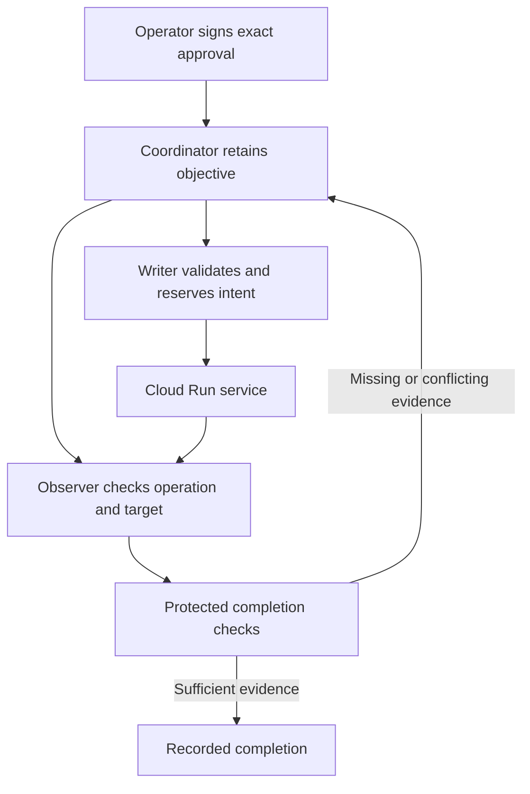

> Historical build decision for 0.1.0, written 11 September 2026. This archive contains the 0.1.1 correction. Current results and limits are in PATCH_NOTES.md and VALIDATION.md; the original 29-test result below is historical.

# Independent build decision: a Balance operator for bounded production changes

**Build one useful operational mechanism: carry an approved change through execution, independent observation and declared completion, while retaining unresolved work when the evidence is insufficient. Start with a Cloud Run canary release.**

I have implemented the first independent candidate, `balance-canary-pilot` v0.1.0. It has a signed approval contract, a persistent objective coordinator, a designated writer, an independent observer interface, protected completion predicates, a Cloud Run v2 REST adapter, an operator CLI, container configuration and a deployment runbook. The final local suite passed 29/29. The container image and live Google Cloud deployment have not been run.

## The first customer and job

The initial user is a platform or application team that already has deployment automation and wants to delegate a bounded release step while retaining reliable authority and outcome records. Customer demand and willingness to pay are hypotheses, not established findings from this build.

The first objective is: **Take this approved candidate revision to a canary of at most 10%, establish that the configured candidate checks pass over the declared observation window, and report either justified completion or the unresolved condition.**

This is a concrete use of objective responsibility under conditional authority. It does not require pretending that the entire Balance vision has already been built. The first runtime uses a deterministic worker; model reasoning can later propose work through the constrained interface without becoming the approval issuer or completion judge.

## Why choose this independently

The accumulated work supports the usefulness of separating authorization, dispatch, effect observation and completion. It also contains reproduced failures in weak completion, post-dispatch crash continuity, intent binding and retry context. Canary release is a suitable initial experiment because the target, revisions, numerical bound and observable state can all be explicit.

The new build puts the connected path into one implementation, without inheriting qualifications from disconnected components. It reserves execution before the external call, refuses automatic mutation retries after ambiguity, keeps native target-version preconditions, and prevents caller-selected checks from determining what the completion claim means.

The real-world proposition still needs testing: whether these controls reduce false completion, inappropriate repeats and recovery effort enough to justify integration and operation.

## The working relationship

The writer's credential is distinct from the observer's, and neither is supplied to the coordinator in the deployment configuration. The approval key stays off the runtime host. These are implemented configuration boundaries awaiting real-host and IAM qualification.

## Relationship to the canonical Balance planes

| Plane | Implemented in this candidate | Remaining scope |
| --- | --- | --- |
| Cognitive | Human preparation of an exact intent; durable objective status available to a later planner. | Autonomous investigation, model planning, memory admission and model-quality evaluation. |
| Decision | Fixed admission conditions and explicit completion policy. | General evidence relevance, domain risk reasoning and richer review decisions. |
| Authority | Operator signature, exact holder/intent/policy binding, short validity and native target-version precondition. | Online per-grant revocation and broader delegation. |
| Consequence | Writer-only mutation path, durable reservation and replay handling. | Live IAM proof, container boundary qualification and managed-identity hosting. |
| Evidence | Signed dispatch/observation records, raw-response hashes, retained uncertainty and completion criteria. | External anchoring and live forensic attribution evidence. |
| Oversight | Explicit operator authorization, visible unresolved state and review escalation. | A complete operational cancellation and uncertain-effect recovery interface. |

This remains one Balance architecture. The candidate is an independent implementation experiment, not a replacement or upgrade of frozen Ground-Zero, Execute, Release Sentinel or the conformance harness. It has not been run against that frozen harness.

## What the local evidence establishes

The 29 tests include a real HTTP exchange between writer and observer services, actual cryptographic verification and SQLite persistence, sixteen concurrent duplicate dispatch requests, and abrupt termination of a child process after a simulated target effect. They also reject weakened completion checks, stale authority, wrong target identity, duplicate evidence and replay after an intervening rollback.

The target provider is simulated in those tests. Google credentials, Docker and a selected live target were unavailable. The optional deployment dependencies could not be installed because network approval was cancelled. This is therefore an implementation candidate with verified local behavior and prepared deployment instructions, not a production-qualified deployment.

## What completion means

The recorded claim is deliberately concrete: a confirmed provider operation is correlated with the approved service state, and the configured candidate probe checks passed at the recorded sample times. It does not establish all release health, every business outcome, or future stability.

The probe itself must be meaningful. An endpoint that always reports success would produce poor evidence even if every signature and hash verified. The application owner must define and review its readiness and smoke-check semantics before the pilot.

A lost provider operation identity remains unresolved even if the desired traffic is observed. The candidate does not manufacture attribution from state alone. This can require operator investigation and hold the next release; that operational cost must be measured.

## How I would take it into a real setting

First deploy the packaged candidate on a dedicated Linux host against one noncritical Cloud Run service. Establish the actual credential and network boundaries, build and pin the image, verify the native etag and operation behavior, and run the positive path plus the bounded failure cases. The deployment runbook supplies the commands and records required.

Before extending to critical production services, implement the operator recovery and revocation/cancellation behavior demanded by the pilot, qualify backups and dependency handling, and validate the application's completion probes. Compare completed objectives, unnecessary reviews, time, cost and recovery effort against the team's existing workflow.

Only then add a model that investigates and prepares changes through the existing interface. Its planning quality must be evaluated separately. The source code's approval and completion conditions remain in force regardless of how persuasive the planner or its memory becomes.

The immediate deployment inputs still missing are a selected test service and its two revisions, a dedicated host, separately scoped writer/observer identities, and the agreed application probe. No cloud mutation or external publication has occurred.

## Package

`BALANCE_Canary_Pilot_0.1.0_2026-09-11.zip` contains the source, tests, validation logs, policy template, key/approval CLI, Dockerfile, compose configuration, preflight, deployment instructions and file manifest. The canonical prior artifacts remain unchanged.
